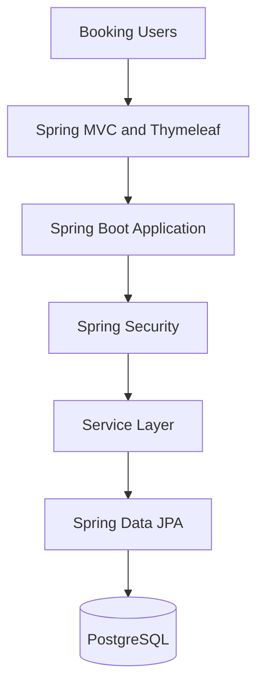
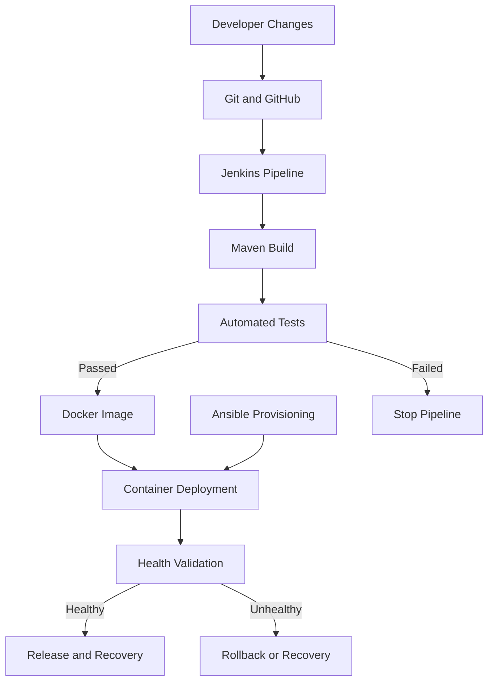

# Ansible-Provisioned Vendor Transport Booking System

A Java-based Vendor Transport Booking System developed alongside a 15-task DevOps lifecycle covering requirements analysis, Agile planning, Git collaboration, continuous integration, automated testing, Docker containerization, Ansible provisioning, deployment validation, and rollback/recovery.

The project demonstrates how a transport booking application can be developed, tested, packaged, deployed, and maintained using modern software engineering and DevOps practices.

> **Project focus:** End-to-end DevOps automation for a Vendor Transport Booking System, from source-code management to deployment and reliability validation.

---

## Table of Contents

- [Project Overview](#project-overview)
- [Problem Statement](#problem-statement)
- [Objectives](#objectives)
- [Scope and Target Users](#scope-and-target-users)
- [Key Application Features](#key-application-features)
- [Technology Stack](#technology-stack)
- [System Architecture](#system-architecture)
- [Application Architecture](#application-architecture)
- [DevOps Workflow](#devops-workflow)
- [15-Task Project Implementation](#15-task-project-implementation)
- [Project Structure](#project-structure)
- [Prerequisites](#prerequisites)
- [Local Setup and Execution](#local-setup-and-execution)
- [Database Configuration](#database-configuration)
- [Testing Strategy](#testing-strategy)
- [Jenkins CI/CD Pipeline](#jenkins-cicd-pipeline)
- [Docker Containerization](#docker-containerization)
- [Ansible Provisioning and Deployment](#ansible-provisioning-and-deployment)
- [Deployment Ports](#deployment-ports)
- [Health Checks and Recovery](#health-checks-and-recovery)
- [Security Considerations](#security-considerations)
- [Troubleshooting](#troubleshooting)
- [Known Limitations](#known-limitations)
- [Future Enhancements](#future-enhancements)
- [Learning Outcomes](#learning-outcomes)
- [Conclusion](#conclusion)

---

## Project Overview

The Vendor Transport Booking System is a web application intended to simplify transport availability management and booking operations. It provides the foundation for users to view available transport slots, request bookings, receive booking confirmations, cancel reservations, and track booking status.

The project also explores the DevOps lifecycle required to deliver and maintain such an application reliably.

The development and deployment workflow incorporates:

- Git and GitHub for source-code management and collaboration.
- Java and Spring Boot for backend application development.
- Maven for dependency management, compilation, testing, and packaging.
- PostgreSQL for persistent data storage.
- Selenium WebDriver for browser-based functional testing.
- Jenkins for continuous integration and automated pipeline execution.
- Docker for application containerization.
- Ansible for environment configuration and deployment automation.
- Spring Boot Actuator for application health monitoring.

The project is organized around **15 academic and practical tasks**, progressing from problem definition and requirements engineering to end-to-end release validation and documentation.

## Problem Statement

Transport booking workflows can involve manual coordination, limited visibility into available transport slots, duplicate reservation requests, and difficulty tracking booking status.

A centralized Vendor Transport Booking System can help organize these operations by providing a structured application for managing users, transport availability, booking requests, confirmations, cancellations, and status updates.

From a software delivery perspective, manually building, testing, configuring, and deploying the application can also introduce inconsistencies and operational errors.

This project addresses both aspects by combining a transport booking application with a DevOps workflow that emphasizes automation, repeatability, testing, deployment validation, and recovery.

## Objectives

1. Develop a web-based application for vendor transport booking operations.
2. Implement the essential booking lifecycle, including availability, booking requests, confirmation, cancellation, and status tracking.
3. Apply Git branching, meaningful commits, pull requests, and release management practices.
4. Automate application builds and testing using Maven and Jenkins.
5. Design Selenium tests for critical user journeys and integrate them into continuous integration.
6. Package the application using Docker and manage its container lifecycle.
7. Automate environment configuration and application deployment using Ansible.
8. Validate deployment health and demonstrate recovery to a previous stable release.
9. Maintain technical documentation, troubleshooting guidance, and project evidence.

## Scope and Target Users

### Target users

- **Transport customers or booking users:** View availability and manage booking requests.
- **Transport vendors or operators:** Manage transport resources and availability, subject to implemented permissions.
- **Administrators:** Manage application operations and authorized administrative functions.
- **Developers:** Maintain source code, implement features, and resolve defects.
- **DevOps engineers:** Automate builds, testing, provisioning, deployment, monitoring, and recovery.

### MVP scope

The minimum viable product is designed to cover:

- User registration and authentication.
- Transport availability and slot viewing.
- Booking request submission.
- Booking confirmation and status tracking.
- Booking cancellation.
- Persistent application data.
- Automated testing and repeatable deployment.

Additional business capabilities, such as payments, live GPS tracking, vendor settlement, and third-party transport integrations, are outside the core MVP scope.

---

## Key Application Features

The following features define the intended application scope. Their implementation and test status should be verified against the current source code before being presented as completed.

| Feature | Description |
|---|---|
| User registration | Create user accounts and validate registration details. |
| Authentication | Authenticate users and enforce appropriate access controls. |
| Transport availability | View available transport resources or booking slots. |
| Booking requests | Submit requests for available transport slots. |
| Booking confirmation | Record and communicate the outcome of a booking request. |
| Booking cancellation | Cancel eligible bookings and update their status. |
| Status tracking | Retrieve the current state of a booking. |
| Persistent storage | Store application entities and booking information in PostgreSQL. |
| Administrative operations | Provide authorized administrative functionality where implemented. |

---

## Technology Stack

| Category | Technology |
|---|---|
| Programming language | Java 21 |
| Backend framework | Spring Boot 4.1.1 |
| Web framework | Spring MVC |
| Frontend rendering | Thymeleaf, HTML, CSS, JavaScript |
| Database | PostgreSQL |
| ORM and data access | Hibernate, Spring Data JPA |
| Application security | Spring Security and JWT-related components |
| Build tool | Apache Maven |
| Unit and integration testing | JUnit and Spring Boot Test |
| Browser automation | Selenium WebDriver 4.27.0 |
| CI/CD | Jenkins Declarative Pipeline |
| Containerization | Docker |
| Infrastructure automation | Ansible |
| Application monitoring | Spring Boot Actuator |
| Version control | Git and GitHub |

*The exact framework versions, dependencies, and supported features should be confirmed against `pom.xml` and the current source configuration.*

---

## System Architecture

The project separates application development from the automation used to build, test, deploy, and maintain it.



### DevOps architecture



The Jenkins and Ansible workflows can be operated independently. Any integration between them should explicitly define how the built artifact, image tag, deployment configuration, and validation results are passed between workflows.

---

## Application Architecture

The backend follows a layered Spring Boot architecture.

| Layer | Responsibility |
|---|---|
| Controller | Handles HTTP requests and returns responses or web pages. |
| Service | Implements application and booking business logic. |
| Repository | Provides database access through Spring Data JPA. |
| Entity | Represents persistent domain objects. |
| DTO | Defines request and response data structures. |
| Configuration | Configures security, JWT-related behavior, and application components. |
| Templates | Contains server-rendered Thymeleaf pages. |
| Static resources | Contains frontend stylesheets and JavaScript. |

### Typical request flow

1. A user submits a request through the web interface.
2. The controller validates and processes the incoming request.
3. The service layer applies the relevant business rules.
4. The repository reads or updates persistent data.
5. The database stores the changes.
6. The application returns the appropriate result to the user.

Transactions and suitable database locking should be used where necessary to protect booking consistency, particularly when multiple users attempt to reserve the same limited-capacity slot.

---

## DevOps Workflow

The project demonstrates the following lifecycle:

1. **Plan:** Define requirements, user stories, acceptance criteria, and the task backlog.
2. **Code:** Implement features using Git branches and version control.
3. **Build:** Compile the Java application and resolve Maven dependencies.
4. **Test:** Execute automated application tests and Selenium browser tests.
5. **Package:** Produce the application artifact and build a Docker image.
6. **Deploy:** Deploy the application to the configured target environment.
7. **Operate:** Inspect logs, check application health, and validate runtime behavior.
8. **Recover:** Restore a previous stable release when deployment validation fails.

The pipeline should prevent deployment when required quality gates fail.

---

## 15-Task Project Implementation

The project follows the 15-task plan below. Each task defines a stage of the development and DevOps lifecycle and its expected deliverables.

### Task 1 — Problem Definition and Scope

**Objective:** Understand the real-world need for the Vendor Transport Booking System.

Activities:

- Identify target users, stakeholders, and their requirements.
- Analyze pain points in transport availability and booking management.
- Define the project objectives and measurable success criteria.
- Identify technical, operational, and time constraints.
- Freeze the minimum viable product scope.

**Expected deliverables:** Problem statement, stakeholder list, objectives, constraints, success criteria, and approved MVP scope.

### Task 2 — Agile Planning and DevOps Workflow

**Objective:** Plan implementation through an organized Agile workflow.

Activities:

- Write user stories and acceptance criteria.
- Create a product backlog containing the 15 project tasks.
- Organize tasks using a Kanban board or Scrum-style sprint plan.
- Define the Definition of Done.
- Document the development-to-operations lifecycle.

**Expected deliverables:** Product backlog, task board, sprint plan, Definition of Done, and DevOps workflow diagram.

### Task 3 — Requirements, Architecture and Technology Setup

**Objective:** Design the application and prepare the development environment.

Activities:

- Define functional and non-functional requirements.
- Design the application architecture and data model.
- Identify the main application endpoints and user journeys.
- Select Java, Spring Boot, Maven, PostgreSQL, and the deployment approach.
- Configure the local development environment.

**Expected deliverables:** SRS summary, use-case diagram, architecture diagram, data model, API list, and working local setup.

### Task 4 — Git and GitHub Repository Initialization

**Objective:** Establish source-code management and repository standards.

Activities:

- Create the GitHub repository.
- Add the README and `.gitignore`.
- Organize the project directory structure.
- Define branch naming conventions and collaboration practices.
- Add issue templates and meaningful initial commits where required.

**Expected deliverables:** GitHub repository, README, initial commits, issue templates, and branch policy.

### Task 5 — Feature Development with Branching

**Objective:** Implement the first core application workflow using collaborative Git practices.

Activities:

- Create a dedicated feature branch.
- Implement the selected application feature.
- Practice Git add, commit, push, pull, and log commands.
- Open a pull request and review the changes.
- Merge the reviewed implementation into the development branch.

**Expected deliverables:** Working feature, feature branch, pull request, review evidence, and merge evidence.

### Task 6 — MVP Completion and Git Collaboration

**Objective:** Complete the essential booking workflow and establish a release-ready source baseline.

Activities:

- Implement registration and authentication.
- Implement availability and slot viewing.
- Implement booking requests, confirmation, cancellation, and status tracking.
- Demonstrate a second feature branch.
- Create and resolve a merge conflict.
- Apply a release tag and update the backlog.

**Expected deliverables:** Functional MVP, merge-conflict resolution evidence, release tag, and updated backlog.

### Task 7 — Jenkins Installation and Continuous Integration

**Objective:** Automate application builds using Jenkins.

Activities:

- Install and configure Jenkins.
- Connect the GitHub repository.
- Configure a Maven build job.
- Set up a commit-triggered webhook or scheduled polling.
- Archive the generated application artifact.

**Expected deliverables:** Configured Jenkins job, successful build log, trigger evidence, and archived artifact.

### Task 8 — Pipeline as Code and Server Deployment

**Objective:** Define the application delivery workflow as code.

Activities:

- Create a Jenkinsfile.
- Add source checkout, build, package, and deployment stages.
- Configure the deployment target.
- Parameterize at least one environment setting.
- Verify the deployed application.

**Expected deliverables:** Jenkinsfile, successful pipeline run, deployment URL or screenshot, and configuration evidence.

### Task 9 — Selenium Test Design and Local Execution

**Objective:** Automate critical user journeys through browser testing.

Activities:

- Identify three to five essential user journeys.
- Write Selenium WebDriver tests with assertions.
- Prepare suitable test data and environment configuration.
- Capture screenshots when failures occur.
- Execute the suite locally through Maven.

**Expected deliverables:** Test plan, Selenium scripts, local test report, and failure screenshot mechanism.

### Task 10 — Continuous Testing in Jenkins

**Objective:** Integrate automated browser tests into the CI pipeline.

Activities:

- Add the Selenium test suite to the Jenkins workflow.
- Publish test reports.
- Configure test failures to stop deployment.
- Introduce a controlled defect in a safe development environment.
- Correct the defect and rerun the pipeline.

**Expected deliverables:** Jenkins test report, failed-pipeline evidence, defect-correction commit, and successful rerun.

### Task 11 — Docker Image and Container Lifecycle

**Objective:** Package the application and understand container operations.

Activities:

- Create a Dockerfile.
- Build and tag the application image.
- Run the container with appropriate port mappings.
- Inspect container status and logs.
- Practice stopping, restarting, and removing containers.

**Expected deliverables:** Dockerfile, image details, Docker command log, and running-container evidence.

### Task 12 — Jenkins-Docker Continuous Deployment

**Objective:** Automate Docker image creation and deployment through Jenkins.

Activities:

- Build a versioned Docker image after successful tests.
- Publish the image to Docker Hub or a local registry, as configured.
- Deploy a fresh container automatically.
- Verify the deployed application.
- Retain sufficient version information for repeatable deployments.

**Expected deliverables:** Versioned image, registry evidence, and end-to-end commit-to-container pipeline.

### Task 13 — Configuration Management with Ansible

**Objective:** Automate configuration of the deployment environment.

Activities:

- Identify required packages, users, directories, files, ports, and services.
- Define the target hosts in an Ansible inventory.
- Write YAML playbooks to configure the environment.
- Automate prerequisites for application or container deployment.
- Execute the playbook and inspect its output.

**Expected deliverables:** Configuration specification, Ansible inventory and playbook, and first execution log.

### Task 14 — Automated Provisioning and Reliability Validation

**Objective:** Validate repeatable provisioning, deployment health, and recovery.

Activities:

- Provision a clean target environment using Ansible.
- Deploy the application or container.
- Run the automation again to evaluate idempotency.
- Perform application health checks.
- Test rollback or recovery to the previous stable release.

**Expected deliverables:** Provisioned environment, idempotency evidence, health-check result, and rollback/recovery demonstration.

### Task 15 — Final End-to-End Release, Documentation and Viva

**Objective:** Demonstrate and document the complete delivery lifecycle.

Activities:

- Run the Git-to-Jenkins build and testing workflow.
- Verify the Selenium quality gate.
- Build and deploy the Docker image.
- Execute Ansible provisioning and validation.
- Document the architecture, setup, troubleshooting, limitations, and future enhancements.
- Prepare the final demonstration and viva presentation.

**Expected deliverables:** Final repository, demonstration, technical report, screenshots or video, presentation, and viva preparation.

---

## Project Structure

The following structure describes the principal source-code and DevOps components. Optional documentation, test, or configuration directories should be confirmed against the current repository.

```text
Vendor-Transport-Booking-System/
├── src/
│   ├── main/
│   │   ├── java/
│   │   │   └── .../
│   │   │       ├── controller/
│   │   │       ├── service/
│   │   │       ├── entity/
│   │   │       ├── repository/
│   │   │       ├── dto/
│   │   │       └── config/
│   │   └── resources/
│   │       ├── templates/
│   │       ├── static/
│   │       └── application.properties
│   └── test/
│       └── java/
├── ansible/
├── db/
│   └── migrations/
├── Dockerfile
├── Jenkinsfile
├── pom.xml
├── .gitignore
└── README.md
```

The exact Java package names and the presence of optional files may differ. Keep this section synchronized with the repository's actual directory tree.

---

## Prerequisites

Install the software required for your chosen development and deployment workflow.

- Java Development Kit (JDK) 21.
- Apache Maven, or the repository's Maven Wrapper if present.
- PostgreSQL.
- Git.
- Docker Desktop or a compatible Docker Engine.
- Jenkins with the required plugins and configured tools.
- Python and Ansible on the automation control machine.
- A compatible Linux deployment target or WSL environment for Ansible-based provisioning.
- A supported web browser and compatible browser driver for Selenium tests.

For a complete DevOps demonstration, Jenkins, Docker, PostgreSQL, and Ansible must be configured for the intended workflow. Not every tool is required to run the application locally.

## Local Setup and Execution

### 1. Clone the repository

```bash
git clone https://github.com/Vaishnaviii-17/Vendor-Transport-Booking-System.git
cd Vendor-Transport-Booking-System
```

### 2. Verify Java and Maven

```bash
java -version
mvn -version
```

Confirm that the active Java installation is version 21.

On Windows, if the Maven Wrapper is present, use:

```powershell
.\mvnw.cmd clean test
```

Otherwise, use the installed Maven executable:

```bash
mvn clean test
```

### 3. Configure PostgreSQL

Create the required database and database user, and ensure the credentials match the application's runtime configuration.

The configured database name is:

```text
vendor_transport_db
```

The application must have valid connection settings before database-backed endpoints can be tested.

### 4. Start the application

After configuring the required environment variables and database:

```powershell
.\mvnw.cmd spring-boot:run
```

Alternatively:

```bash
mvn spring-boot:run
```

The documented direct application port is `8083`. Confirm the active Spring Boot configuration before accessing the application.

### 5. Verify application health

If the Actuator health endpoint is enabled and accessible:

```text
http://localhost:8083/actuator/health
```

A healthy response should indicate that the application is running and the configured health indicators are passing. The exact response depends on the Actuator configuration.

---

## Database Configuration

The application uses PostgreSQL for persistent data storage and Spring Data JPA/Hibernate for database access.

The documented database name is `vendor_transport_db`.

Configure connection settings using the application's supported properties or environment-variable overrides. For example, the following names can be used if they match the application's configuration:

```text
DB_URL=jdbc:postgresql://localhost:5432/vendor_transport_db
DB_USERNAME=your_database_user
DB_PASSWORD=your_database_password
```

These variable names are examples; verify the actual property placeholders in the current `application.properties` file.

**Important:** Never commit real database passwords, production credentials, JWT signing secrets, or other sensitive values to GitHub. Use environment variables or an appropriate secrets-management mechanism.

If Hibernate is configured with `ddl-auto=validate`, the required schema must already exist. Ensure that the documented SQL migrations or another supported schema-management process are executed before starting the application.

---

## Testing Strategy

Testing is intended to validate the application at multiple levels.

### Unit and integration tests

Use JUnit and Spring Boot testing support to validate service logic, data access, configuration, and application behavior.

Recommended areas include:

- Input validation.
- Booking eligibility.
- Availability and capacity checks.
- Booking status transitions.
- Cancellation rules.
- Authorization and access control.
- Database transaction behavior.

### Selenium functional tests

Automate three to five critical user journeys, such as:

1. Register and authenticate a user.
2. View available transport slots.
3. Submit a valid booking request.
4. Verify booking confirmation and status.
5. Cancel an eligible booking and verify the updated status.

The final test list should reflect the actual implemented user interface and application behavior.

### Quality gate

The intended CI/CD workflow should enforce the following sequence:

```text
Source checkout
      |
      v
Maven build and tests
      |
      v
Selenium functional tests
      |
      +---- Failure ----> Stop pipeline and publish reports
      |
      v
Build Docker image
      |
      v
Deploy and validate
```

Do not treat the presence of test files or compiled classes as evidence that tests passed. Publish actual test reports from the relevant execution.

---

## Jenkins CI/CD Pipeline

The repository includes a Jenkins Declarative Pipeline intended to automate application build, testing, packaging, and deployment.

The documented pipeline has eight stages:

1. Checkout source code.
2. Compile the application.
3. Run unit tests.
4. Package the application.
5. Check application availability.
6. Run Selenium tests.
7. Build the Docker image.
8. Deploy the container.

The exact stage names and behavior should be verified against the current `Jenkinsfile`.

### Pipeline requirements

- Configure Jenkins with the required JDK, Maven, Git, Docker, and browser-testing dependencies.
- Connect Jenkins to the GitHub repository.
- Configure a webhook or scheduled polling trigger.
- Keep credentials in Jenkins Credentials rather than hard-coding them.
- Publish JUnit-compatible test reports.
- Stop the pipeline when required tests fail.
- Archive build artifacts and retain useful logs.
- Verify the application after deployment.

A pipeline stage that checks an existing application on port `8083` depends on that application already running. For a reproducible CI workflow, launch a dedicated test instance as part of the pipeline or use a separately managed test environment, and clean it up afterward.

---

## Docker Containerization

Docker packages the application and its runtime dependencies into a container image.

### Typical Docker workflow

```bash
docker build -t vendor-transport-booking:latest .
docker images
docker run -d --name vendor-transport-booking -p 8084:8083 vendor-transport-booking:latest
docker ps
docker logs vendor-transport-booking
docker stop vendor-transport-booking
docker start vendor-transport-booking
docker rm -f vendor-transport-booking
```

These commands illustrate the container lifecycle. Use the repository's actual image name, configured ports, and environment variables when executing them.

### Important configuration considerations

- The application must listen on the container's configured internal port.
- PostgreSQL must be reachable from the container through a valid network configuration.
- Database credentials must be provided securely.
- A health check should verify application readiness.
- Image tags should identify the version being deployed.
- Containers should be replaced with newly tested versions rather than relying on mutable tags alone.

The Jenkins workflow is documented as managing a container on host port `8084`, mapped to application port `8083`.

---

## Ansible Provisioning and Deployment

Ansible automates the configuration of the deployment environment and the execution of deployment tasks.

The project includes a separate Ansible workflow intended to validate a candidate deployment before promoting a release to production.

### Provisioning responsibilities

Depending on the configured playbook, provisioning can include:

- Preparing the target host.
- Installing required packages.
- Creating application directories.
- Configuring required services and ports.
- Ensuring the appropriate Docker image is available.
- Deploying the application container.
- Checking application health.
- Retaining the previous stable version for recovery.

### Candidate and production deployment

The documented workflow uses:

| Environment | Host port |
|---|---:|
| Direct application | 8083 |
| Jenkins-managed container | 8084 |
| Ansible-managed production deployment | 8085 |
| Ansible candidate deployment | 8086 |

### Example Ansible commands

Run these commands from the directory containing the appropriate inventory and playbook, adjusting filenames to match the repository:

```bash
ansible --version
ansible-inventory -i inventory.ini --list
ansible-playbook -i inventory.ini playbook.yml --syntax-check
ansible-playbook -i inventory.ini playbook.yml --check
ansible-playbook -i inventory.ini playbook.yml
```

The check mode does not guarantee that every action can be simulated. Review the output and use the actual playbook's supported variables and inventory.

### Idempotency

Ansible automation should converge the environment to the desired state. Running the playbook again without configuration changes should not unnecessarily recreate resources or change already-correct settings.

### Deployment integration

Jenkins and Ansible are documented as separate workflows. To combine them into a single release pipeline, explicitly pass the tested image tag and deployment parameters between the two systems and validate the image provenance before promotion.

---

## Health Checks and Recovery

The project includes a deployment-validation and recovery workflow.

A typical release-validation sequence is:

1. Deploy a candidate version.
2. Wait for the application to become ready.
3. Check the health endpoint.
4. Validate critical application functionality.
5. Promote the candidate to production only after successful checks.
6. Restore the previous stable release if deployment validation fails.

Spring Boot Actuator can expose application health through:

```text
/actuator/health
```

The full URL depends on the configured host port and application context path.

### Recovery considerations

- Record the previous stable image tag.
- Retain the configuration required to restart the previous release.
- Confirm the previous image is available before attempting recovery.
- Recheck application health after rollback.
- Verify database compatibility between application versions.
- Record the failure reason and recovery outcome.

A rollback mechanism should be described as tested only after the recovery procedure has actually been executed and verified.

---

## Security Considerations

Security is an important part of both the application and its delivery pipeline.

- Use Spring Security to protect authenticated routes.
- Verify that authorization rules enforce the correct roles and permissions.
- Store passwords using a suitable password-hashing mechanism.
- Protect JWT signing secrets and database credentials.
- Avoid committing `.env` files containing real credentials.
- Use least-privilege permissions for Jenkins and deployment accounts.
- Restrict access to management endpoints such as Actuator.
- Avoid exposing unnecessary authentication details in production logs.
- Review dependency versions and security advisories.
- Restrict inbound network access to the ports required by the application.

Authentication dependencies alone do not establish that JWT issuance, validation, and role-based authorization are correctly configured. Verify the actual security implementation.

---

## Troubleshooting

| Problem | Possible cause | Recommended action |
|---|---|---|
| PostgreSQL authentication failure | Incorrect username or password | Verify database credentials, environment variables, and PostgreSQL role configuration. |
| Database connection refused | PostgreSQL is stopped or unreachable | Start PostgreSQL and verify the host, port, and network configuration. |
| Schema validation failure | Tables or columns are missing or incompatible | Apply the required database migrations and verify the schema. |
| Maven build failure | Incorrect JDK, dependency resolution, or compilation error | Check `java -version`, inspect Maven output, and resolve the first reported error. |
| Jenkins application check fails | No application is listening on the expected port | Start the test application or make the pipeline manage its lifecycle. |
| Selenium test failure | Browser, driver, application, or test-data mismatch | Check browser compatibility, application readiness, screenshots, and test logs. |
| Docker container exits | Startup failure, missing configuration, or database connectivity issue | Inspect `docker logs` and verify the runtime environment. |
| Port already allocated | Another process or container is using the port | Inspect active listeners and containers, then choose a suitable free port. |
| Ansible cannot connect | SSH credentials, inventory, or target configuration issue | Verify inventory values, SSH connectivity, and target-host prerequisites. |
| Health check fails after deployment | Application is not ready or a dependency is unavailable | Inspect application logs, database connectivity, and health-indicator details. |
| Rollback fails | Previous image or configuration is unavailable | Verify retained release artifacts and recovery settings before deployment. |

---

## Known Limitations

The following points should be evaluated before treating the project as production-ready:

- The business workflows must be verified against the actual implementation and automated tests.
- A clean build and full test execution should be recorded as release evidence.
- Database schema creation and migration must be reproducible.
- CI should not depend on a manually started local application.
- Docker and deployment scripts should avoid machine-specific executable paths.
- Jenkins and Ansible require explicit artifact and image-version coordination if a unified release workflow is desired.
- Production use would require additional hardening of credentials, access control, observability, backup, and recovery procedures.
- Any deployment ports, commands, screenshots, and success claims should match the actual environment.

These limitations distinguish the intended project architecture from behavior that must be demonstrated during testing.

---

## Future Enhancements

Potential improvements include:

1. **Unified CI/CD:** Integrate Jenkins and Ansible into a single artifact-driven release pipeline.
2. **Cloud deployment:** Deploy the application to a cloud-hosted virtual machine or container platform.
3. **Centralized logging:** Introduce structured logs and centralized log collection.
4. **Metrics and dashboards:** Add Prometheus and Grafana where appropriate.
5. **Database migration automation:** Adopt Flyway or Liquibase for versioned schema management.
6. **API documentation:** Generate interactive API documentation using OpenAPI.
7. **Improved automated testing:** Add coverage reporting and tests for concurrent booking requests.
8. **Release management:** Use immutable image tags and documented release promotion.
9. **Backup and restore:** Automate PostgreSQL backups and validate restoration procedures.
10. **Infrastructure security:** Introduce stronger secrets management, network restrictions, and dependency scanning.
11. **Container orchestration:** Evaluate Kubernetes if deployment complexity justifies it.
12. **Application enhancements:** Consider booking notifications, advanced search, reporting, and role-specific dashboards.

---

## Learning Outcomes

This project provides practical experience with:

- Requirements analysis and Agile planning.
- Java and Spring Boot application development.
- Relational database integration using PostgreSQL.
- Git branching, commits, pull requests, and conflict resolution.
- Maven build and dependency management.
- Jenkins continuous integration and pipeline automation.
- Selenium-based browser testing.
- Docker image creation and container lifecycle management.
- Ansible configuration management and provisioning.
- Health validation, deployment reliability, and rollback planning.
- Technical documentation, troubleshooting, and release preparation.

---

## Conclusion

The Ansible-Provisioned Vendor Transport Booking System combines a transport booking application with a structured 15-task DevOps workflow. It connects requirements engineering and application development with version control, automated builds, functional testing, containerization, infrastructure provisioning, and deployment validation.

The project's objective is to demonstrate a repeatable software delivery process in which changes can be built, tested, deployed, monitored, and recovered in a controlled manner.

The final project assessment should be supported by actual build results, test reports, deployment evidence, health checks, and recovery demonstrations.

---

## Project Repository

**GitHub:** https://github.com/Vaishnaviii-17/Vendor-Transport-Booking-System

**Project title:** Ansible-Provisioned Vendor Transport Booking System

**Primary focus:** Java Application Development, CI/CD Automation, Docker Containerization, Selenium Testing, and Ansible-Based Provisioning.
