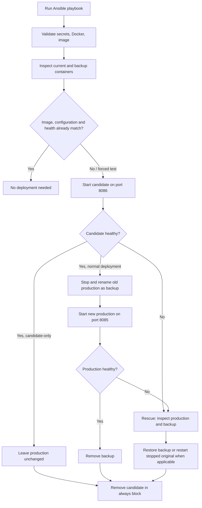

# Ansible Deployment, Idempotency, and Rollback

**Project:** Vendor Transport Booking System
**Task:** 14 implementation evidence / Task 15 operational documentation
**Deployment target:** Local Docker Desktop engine accessed from WSL Ubuntu

## 1. Scope

This playbook deploys the existing Spring Boot Docker image through **Ansible independently of the Jenkins deployment**. The Jenkins-managed application uses host port `8084`; the Ansible-managed application uses `8085`. Ansible first checks a temporary candidate on `8086`, then promotes the requested image if necessary. It does **not** build the image or invoke Jenkins.

## 2. Configuration and topology

| Item | Configured value |
| --- | --- |
| Playbook | `ansible/deploy.yml` |
| Inventory | `ansible/inventory.ini` (`local`, localhost connection) |
| Ansible configuration | `ansible/ansible.cfg` |
| Variables | `ansible/group_vars/all.yml` |
| Application container | `vendor-transport-ansible` |
| Candidate container | `vendor-transport-ansible-candidate` |
| Backup container | `vendor-transport-ansible-backup` |
| Docker image | `vendor-transport-booking:7` |
| Container port | `8083` |
| Production host port | `8085` |
| Candidate host port | `8086` |
| Database | `jdbc:postgresql://host.docker.internal:5432/vendor_transport_db` |
| Health endpoints | `http://localhost:8085/actuator/health`, `http://localhost:8086/actuator/health` |
| Health retry configuration | 36 retries; 5-second delay |

The configured image tag is a **local image tag**, not a registry-based immutable release identifier. Update `image_tag` in `all.yml` (or override it using Ansible extra variables) when deploying a new locally available image.



## 3. Prerequisites

- Windows host with Docker Desktop running and a working Linux-container Docker context.
- WSL Ubuntu with Ansible installed; tested with Ansible `2.16.3`.
- `community.docker` collection and Docker Python SDK available to the Python interpreter used by Ansible.
- A locally built Docker image matching `image_name:image_tag` (`vendor-transport-booking:7` in the submitted configuration).
- PostgreSQL available to containers at `host.docker.internal:5432` and database `vendor_transport_db` configured.
- Required environment variables in the **same WSL shell**: `DB_USERNAME`, `DB_PASSWORD`, `JWT_SECRET`. Never commit their values or include them in screenshots.
- Free host port `8086` for candidate validation; production uses `8085`.

The project previously used the Docker SDK installed in `~/.venvs/ansible-docker` and supplied that interpreter explicitly. A warning that the installed `community.docker` collection does not officially support Ansible `2.16.3` was observed, although the recorded tests completed. Verify a compatible collection/Ansible combination before using this workflow beyond the local project environment.

## 4. Preflight checks

Run in **WSL Ubuntu**:

```bash
cd /mnt/c/Sem-7/DevOpps/Project/Vendor-Transport-Booking-System/ansible
export ANSIBLE_CONFIG="$PWD/ansible.cfg"

ansible-playbook --syntax-check deploy.yml
docker image inspect vendor-transport-booking:7 --format '{{.Id}}'
curl -fsS http://localhost:8085/actuator/health
```

If this is the first deployment, the last health request may fail because no production container exists yet. Check the Docker image and database prerequisites before proceeding.

## 5. Normal deployment

Run only after the required secret variables are exported in the WSL shell:

```bash
ansible-playbook \
  -e "ansible_python_interpreter=$HOME/.venvs/ansible-docker/bin/python" \
  deploy.yml
```

The playbook:

1. Asserts the three secret variables are present, verifies Docker connectivity and checks the requested image exists.
2. Inspects the current application and any existing backup; refuses to proceed if an old backup already exists.
3. Compares the running container's image ID, required environment values, port binding and health response with the requested state.
4. Skips deployment if the existing application already matches and reports health status `UP`.
5. Otherwise, starts the candidate on port `8086` and waits for HTTP `200` with JSON `status: UP`.
6. Stops and renames the old production container to the backup name, starts the replacement on `8085`, and checks its health.
7. Removes the backup after successful production validation and removes the temporary candidate in the `always` block.

**Availability note:** Candidate verification happens before promotion, but production promotion stops the existing container before starting the replacement on the same host port. This design has a short **service interruption**; it is not zero-downtime or blue/green traffic switching.

## 6. Candidate-only validation

To test a candidate without promoting it to production:

```bash
ansible-playbook \
  -e "ansible_python_interpreter=$HOME/.venvs/ansible-docker/bin/python" \
  -e "force_candidate_test=true" \
  deploy.yml
```

Expected: candidate becomes healthy; production stop/rename/redeploy tasks are skipped; the candidate is removed. The recorded successful test ended with `ok=17 changed=2 failed=0 skipped=6 rescued=0`.

### Controlled candidate failure

The following intentionally checks a nonexistent endpoint. It is a **negative test** and is expected to exit nonzero:

```bash
ansible-playbook \
  -e "ansible_python_interpreter=$HOME/.venvs/ansible-docker/bin/python" \
  -e "force_candidate_test=true" \
  -e "candidate_health_check_url=http://localhost:8086/actuator/invalid-test" \
  -e "health_check_retries=2" \
  -e "health_check_delay=2" \
  deploy.yml
```

In the recorded run, the candidate health check failed with a connection-reset response, the rescue path executed, and `always` removed the candidate (`ok=17 changed=2 failed=1 rescued=1`). Because the endpoint did not return an HTTP 404 in that run, this establishes **failure handling and cleanup**, not a specific HTTP error code.

## 7. Production rollback simulation (disruptive)

**Run only in an authorized local/test environment with no active bookings or important users.** This deliberately interrupts the Ansible-managed production service on port `8085` and forces a failed deployment. It does not intentionally alter database records, but any in-flight requests can be interrupted.

The uploaded `deploy.yml` contains a test-only `simulate_production_failure` condition after starting the replacement production container. Run:

```bash
ansible-playbook \
  -e "ansible_python_interpreter=$HOME/.venvs/ansible-docker/bin/python" \
  -e "simulate_production_failure=true" \
  deploy.yml
```

Expected sequence: candidate health passes → old production stops and is renamed as backup → new production starts → intentional failure → rescue removes replacement → backup is renamed to the original name → original container restarts and becomes healthy → candidate is removed. The playbook intentionally exits with `failed=1` to report that the deployment itself failed.

**Observed Task 14 evidence:** `ok=26 changed=8 failed=1 skipped=4 rescued=1`; output explicitly reported `Automatic rollback completed. Previous production container is healthy.` The original container ID was restored:

```text
13ae7b0cf274aa3061291a3d081cb8650d3ca01f89d4cc789eceaf5086bbb442
```

The restored container reported image `vendor-transport-booking:7`, running state `true`, and Actuator health `UP`. No candidate or backup container remained.

## 8. Verify deployment and cleanup

```bash
docker inspect vendor-transport-ansible --format '{{.Id}}'
docker inspect vendor-transport-ansible --format '{{.Config.Image}}'
docker inspect vendor-transport-ansible --format '{{.State.Running}}'
curl -fsS http://localhost:8085/actuator/health
docker ps -a --filter "name=vendor-transport-ansible-candidate"
docker ps -a --filter "name=vendor-transport-ansible-backup"
```

A successful health check returns JSON with `"status":"UP"`. The candidate and backup listings should contain no matching containers after a completed run.

## 9. Idempotency

After a successful deployment or rollback, rerun the **normal** playbook without test flags. When image ID, environment, port binding and health match, the deployment block is skipped. The recorded final run reported:

```text
Candidate-only mode: False. Deployment required: False.
localhost : ok=11 changed=0 unreachable=0 failed=0 skipped=13 rescued=0 ignored=0
```

This is evidence of idempotency **for the tested local configuration**, not a guarantee that every possible Docker change or failure mode is handled.

## 10. Failure handling and manual recovery

| Condition | Playbook behavior | Operator action |
| --- | --- | --- |
| Required secret missing | Preflight assertion fails | Set variables securely; rerun |
| Docker daemon unavailable | Preflight fails | Start Docker Desktop; check `docker info` |
| Requested image missing | Rejects before changing production | Build/load the expected image; confirm tag |
| Backup container already exists | Refuses to deploy | Inspect before changing or removing any container |
| Candidate health fails | Enters rescue; candidate removed in `always` | Check logs, image, DB access and endpoint |
| Production fails after backup rename | Removes failed replacement and restores backup | Verify health and original image/container |
| Original stopped but not yet renamed | Attempts to restart original container | Verify health and inspect errors |
| Recovery itself fails | Manual intervention may be needed | Preserve containers/logs; restore only after inspection |

### Safe diagnostic commands

```bash
docker ps -a --filter "name=vendor-transport-ansible"
docker logs --tail 100 vendor-transport-ansible
docker inspect vendor-transport-ansible --format '{{.State.Status}}'
curl -fsS http://localhost:8085/actuator/health
```

If a backup remains after an interrupted deployment, **do not immediately delete it or rerun the playbook**. First inspect both production and backup containers:

```bash
docker ps -a --filter "name=vendor-transport-ansible"
docker inspect vendor-transport-ansible-backup --format '{{.Id}} {{.State.Status}}'
```

Only when you have confirmed which container should be restored and the production name/port is available, a typical manual restore of a **stopped** backup is:

```bash
# CAUTION: perform only after inspecting and resolving any existing
# container using the production name and host port 8085.
docker rename vendor-transport-ansible-backup vendor-transport-ansible
docker start vendor-transport-ansible
curl -fsS http://localhost:8085/actuator/health
```

If a production container with that name exists, `docker rename` will fail; do **not** blindly remove it. Inspect and preserve evidence before taking action. A healthy backup should not be deleted until recovery is confirmed.

## 11. Security and operational limitations

- Secrets are read from environment variables, not committed into YAML. Tasks handling container environments use `no_log: true`; still avoid printing Docker inspect environment data in evidence screenshots.
- The database URL points to a PostgreSQL instance accessible through Docker Desktop's host gateway. This is a **local lab topology**, not a cloud production architecture.
- Rollback restores the **previous Docker container**. It does **not** roll back database schema changes or data migrations.
- Health checks validate Actuator availability and reported status; they do not prove every booking workflow is functional.
- The simulation flag should never be enabled during normal deployment.
- The playbook refuses an existing backup to avoid silently overwriting a possible recovery point.
- Candidate cleanup is in `always`, but failures such as an unavailable Docker daemon may prevent cleanup and require manual inspection.
- The workflow has not been demonstrated as safe for concurrent deployment executions or high-availability production use.

## 12. Task 15 evidence checklist

Save redacted screenshots/logs under `docs/screenshots/`:

- [ ] Syntax check showing `playbook: deploy.yml`
- [ ] Candidate-only success showing production tasks skipped
- [ ] Candidate failure showing `rescue` and cleanup
- [ ] Simulated production failure showing successful rollback
- [ ] Original container ID and `UP` health after rollback
- [ ] Final idempotency run showing `changed=0 failed=0`
- [ ] Docker listing showing no leftover candidate or backup

Do not include passwords, JWT secrets, full container environment dumps or personal tokens in evidence.
