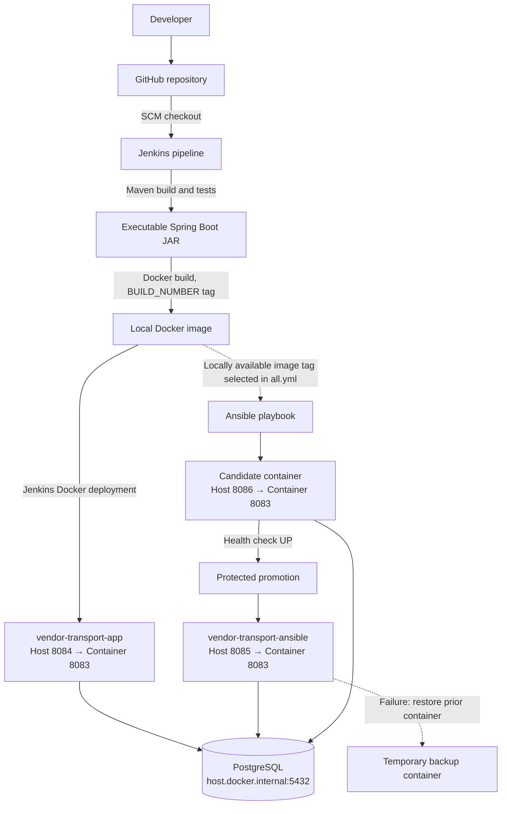
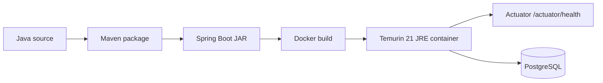
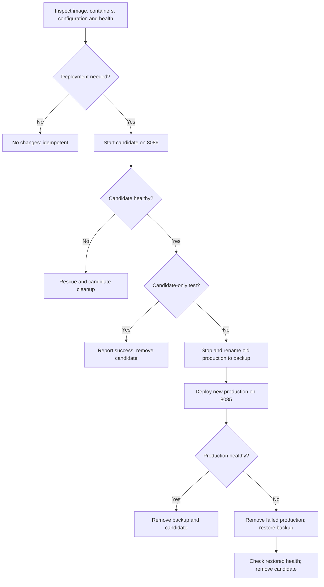

# System Architecture — Vendor Transport Booking System

## 1. Purpose and scope

This document describes the architecture supported by the project's uploaded `pom.xml`, `Dockerfile`, `Jenkinsfile`, and Ansible configuration. The application is a Java/Spring Boot transport-booking system backed by PostgreSQL. The deployment automation has two **separate** paths: Jenkins-managed Docker deployment and Ansible-managed Docker deployment. The current Jenkinsfile does not execute Ansible.

## 2. High-level architecture

**Diagram note:** The dashed image-to-Ansible arrow represents an image that is already present locally, **not** an automated Jenkins-to-Ansible trigger or image-tag handoff. Ansible's current image tag is configured independently.

## 3. Application components

| Component | Technology / role | Evidence |
| --- | --- | --- |
| Web application | Java 21, Spring Boot 4.1.1 | `pom.xml` |
| HTTP layer | Spring Web MVC; Thymeleaf dependency | `pom.xml` |
| Persistence | Spring Data JPA and PostgreSQL driver | `pom.xml` |
| Security | Spring Security; OAuth2 Resource Server dependency | `pom.xml` |
| Monitoring | Spring Boot Actuator health endpoint | `pom.xml`, Jenkins and Ansible health checks |
| Build and packaging | Maven, executable JAR | `pom.xml`, `Jenkinsfile`, `Dockerfile` |
| Container runtime | Docker, Eclipse Temurin 21 JRE | `Dockerfile` |
| CI/CD | Jenkins declarative pipeline | `Jenkinsfile` |
| Deployment automation | Ansible and `community.docker` | `ansible/deploy.yml` |

The uploaded infrastructure files do not establish the complete controller routes, domain business logic, UI pages, or database schema. Document these separately after reviewing application source files.

## 4. Runtime topology and ports

| Runtime | Container / process | Host port | Internal port | Health endpoint |
| --- | --- | ---: | ---: | --- |
| Local development | Spring Boot application | 8083 | N/A | `http://localhost:8083/actuator/health` |
| Jenkins deployment | `vendor-transport-app` | 8084 | 8083 | `http://localhost:8084/actuator/health` |
| Ansible deployment | `vendor-transport-ansible` | 8085 | 8083 | `http://localhost:8085/actuator/health` |
| Ansible candidate | `vendor-transport-ansible-candidate` | 8086 | 8083 | `http://localhost:8086/actuator/health` |
| Database | PostgreSQL on Windows host | 5432 | N/A | Database connection, not HTTP |

Docker containers use `jdbc:postgresql://host.docker.internal:5432/vendor_transport_db` to reach PostgreSQL on the host. Jenkins backend/Selenium test stages instead set a `localhost:5432` database URL for tests running on the Windows agent.

## 5. Application container lifecycle

The Dockerfile starts from `eclipse-temurin:21-jre`, copies `target/vendor-transport-booking-0.0.1-SNAPSHOT.jar` into `/app/app.jar`, exposes port 8083, and starts it with `java -jar app.jar`.

## 6. Deployment paths

### 6.1 Jenkins-managed deployment

The Jenkins pipeline checks out code, compiles, runs backend tests, checks the locally running application, runs headless Selenium tests, packages the JAR, builds `vendor-transport-booking:<BUILD_NUMBER>`, and deploys `vendor-transport-app` to host port 8084. If an existing container is present, the pipeline preserves it under a backup name while verifying the replacement. A failed deployment triggers a best-effort restore of the backup.

### 6.2 Ansible-managed deployment

The Ansible playbook checks secrets, Docker connectivity, image availability, current container configuration, and application health. For a required change, it launches a temporary candidate on port 8086, waits for `UP`, and (unless candidate-only testing is enabled) stops and renames the current production container before deploying a replacement on port 8085. Failure triggers recovery logic; `always` cleans up the candidate. A successful promotion removes the backup.

The real rollback simulation from Task 14 restored the original container ID and verified `status: UP`. This establishes the tested local rollback path, not a guarantee of recovery from every possible host or Docker failure.

## 7. Configuration and secrets

- `ansible/group_vars/all.yml` contains non-secret image, port, health-check, and database URL settings; current image tag is `7`.
- `DB_USERNAME`, `DB_PASSWORD`, and `JWT_SECRET` are read from environment variables by Ansible.
- Jenkins obtains these values through Jenkins credentials IDs `vendor-db-username`, `vendor-db-password`, and `vendor-jwt-secret`.
- Never commit actual secret values, deployment `.env` files, or screenshots exposing credentials.
- Jenkins has a machine-specific `DOCKER_EXE` path; deployment to a different host requires adjusting it.

## 8. Boundaries and operational assumptions

This is a local, single-host demonstration architecture, not a multi-node production cluster. The playbook and Jenkins pipeline independently manage different containers, and both assume the database is reachable. The Ansible candidate and production share the same database, so candidate testing is not database-isolated. Promotion on port 8085 stops the old container before starting the new one, so brief downtime is possible. The `community.docker` compatibility warning observed with Ansible 2.16.3 should be resolved or recorded as a known environment limitation.

## 9. Evidence to capture

Capture the Jenkins stage view, both Docker deployment containers, successful health endpoints on 8084/8085, Ansible candidate-only test, simulated rollback log, and post-rollback idempotent play recap. Screenshots should be added under `docs/screenshots/` after redacting sensitive values.
