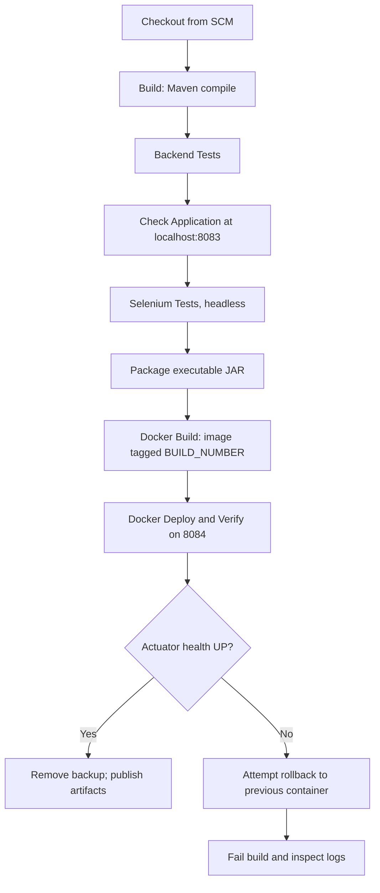
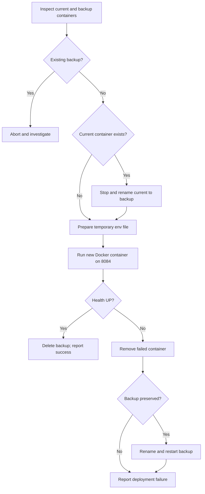

# CI/CD Pipeline — Vendor Transport Booking System

## 1. Overview

The repository's `Jenkinsfile` defines a declarative Jenkins pipeline that compiles the Spring Boot application, runs backend and Selenium tests, packages a JAR, builds a Docker image, and deploys it to the **Jenkins-managed** container on host port **8084**. Ansible is a separate deployment workflow; the Jenkinsfile does not call `ansible-playbook`.

## 2. Jenkins pipeline diagram



The pipeline is sequential; a failed stage prevents normal execution of subsequent stages. Post-build actions publish test reports and eligible artifacts.

## 3. Stage-by-stage implementation

| Stage | What it does | Relevant implementation |
| --- | --- | --- |
| Checkout | Fetches source from configured SCM | `checkout scm` |
| Build | Compiles Java source | `mvn -B -DskipTests compile` |
| Backend Tests | Runs tests except Selenium class | `mvn -B "-Dtest=*,!VendorTransportSeleniumTest" test` |
| Check Application | Polls locally running application at port 8083 | Up to 12 checks with 5-second sleeps |
| Selenium Tests | Runs browser test class in headless mode | `mvn -B "-Dtest=VendorTransportSeleniumTest" "-Dselenium.headless=true" test` |
| Package | Creates JAR | `mvn -B -DskipTests package` |
| Docker Build | Builds image tagged with Jenkins build number | `vendor-transport-booking:<BUILD_NUMBER>` |
| Docker Deploy and Verify | Replaces `vendor-transport-app` and checks health | `-p 8084:8083`, `/actuator/health` |

The **Check Application** stage does not start the app. It assumes something is already serving HTTP at `http://localhost:8083`. This is an important prerequisite when reproducing the pipeline.

## 4. Jenkins agent and tools

The Jenkinsfile uses `agent any` and declares Jenkins tool installations named `JDK-21` and `Maven-3.9.16`. It runs Windows `bat` and PowerShell commands, so the selected agent must support those commands. It disables concurrent builds and default checkout, then performs an explicit SCM checkout. Timestamps are enabled in logs.

The Docker executable path is configured in `DOCKER_EXE` and is specific to the development machine. On another Windows agent, update this path or adjust the pipeline to use an appropriately configured Docker CLI.

## 5. Secrets and environment

The pipeline reads Jenkins **Secret text** credentials using these IDs:

| Jenkins credential ID | Environment variable |
| --- | --- |
| `vendor-db-username` | `DB_USERNAME` |
| `vendor-db-password` | `DB_PASSWORD` |
| `vendor-jwt-secret` | `JWT_SECRET` |

The test stages use `jdbc:postgresql://localhost:5432/vendor_transport_db`. The Docker deployment uses `jdbc:postgresql://host.docker.internal:5432/vendor_transport_db`. During deployment, the script creates a temporary `.docker-deploy.env` file in the Jenkins workspace, supplies it to `docker run --env-file`, and removes it in both the normal and `finally` paths. Restrict workspace access and ensure the file is never committed or archived.

## 6. Docker deployment and recovery

The deploy stage:

1. Checks whether `vendor-transport-app` and its backup already exist.
2. Rejects deployment if a backup is already present.
3. Stops and renames the existing container to `vendor-transport-app-backup` when applicable.
4. Writes the temporary deployment environment file.
5. Runs `vendor-transport-booking:<BUILD_NUMBER>` as `vendor-transport-app` with `--restart unless-stopped` and `-p 8084:8083`.
6. Polls `http://localhost:8084/actuator/health` for JSON `status: UP` (up to 36 iterations with 5-second sleeps).
7. Removes the previous backup on success.
8. On failure, attempts to remove the failed container, rename the backup, and start it again, then rethrows the failure.



**Recovery limitation:** The Jenkins catch block logs a successful container restart but does not perform a second Actuator health check after restoring the backup. Treat rollback as **best effort**, and verify `http://localhost:8084/actuator/health` manually after a failed deployment.

## 7. Test results and artifacts

The `post` section always publishes JUnit XML files matching `target/surefire-reports/*.xml` and attempts to archive Selenium screenshots from `target/selenium-screenshots/**/*.png`. On a successful pipeline, it archives `target/*.jar`. Screenshot archival permits an empty result, so the pipeline configuration alone does not prove that screenshots were produced.

For the final report, capture actual Jenkins build number, console output, stage status, test report totals, and screenshots. Do not claim exact pass counts without their corresponding logs.

## 8. Running and verifying the pipeline

Before triggering Jenkins, verify:

- Java 21 and Maven installations are registered with the Jenkins names used in the file.
- The agent supports Windows batch and PowerShell, Docker Desktop is available, and `DOCKER_EXE` points to a valid executable.
- PostgreSQL is reachable and the three Jenkins credential IDs exist.
- The application is running and responds at `http://localhost:8083` for the Check Application and Selenium stages.
- Docker port 8084 is available or occupied by the Jenkins-managed container intended for replacement.

After a successful build, check:

```powershell
Invoke-RestMethod http://localhost:8084/actuator/health
docker ps --filter "name=vendor-transport-app"
```

## 9. Relationship to Ansible

Ansible is run separately from WSL Ubuntu using `ansible/deploy.yml`. It uses its own configured image tag (currently `7`), validates a candidate on host port `8086`, and deploys its production container on host port `8085`. The Jenkins pipeline does **not** automatically pass `BUILD_NUMBER` to Ansible or trigger the playbook. This distinction should be retained in diagrams and presentations.

## 10. Known limitations and improvement opportunities

- The application must already be running on port 8083 before the Check Application stage.
- The Docker CLI path is machine-specific.
- Jenkins and Ansible are not linked in one automated promotion pipeline.
- Jenkins rollback restart is not followed by a health recheck.
- Both deployments share the same PostgreSQL instance, so tests and deployments require care with database state.

These are documented properties of the current implementation, not changes required to complete the documentation task.
